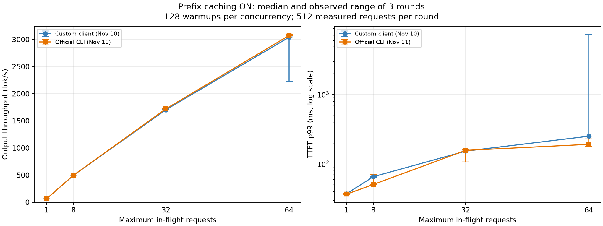
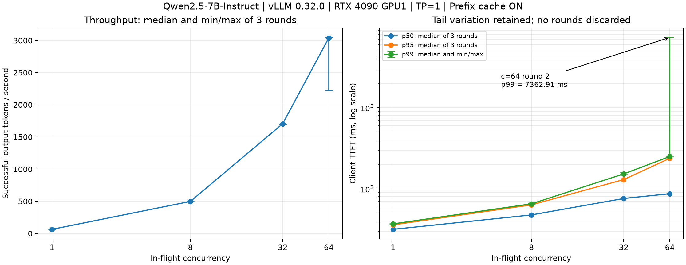

# 项目 0：环境 + 基线压测（约 1 周）

## 目标

在本机跑通第一个 vLLM 服务，并建立**可信、可复现**的性能基线。后续所有优化都以这里的数据为对照。

## 前置

1. `bash scripts/check_env.sh`，把结果填入 [`docs/environment.md`](../docs/environment.md)
2. `bash scripts/setup_env.sh` 创建 `.venv`
3. `bash scripts/clone_upstream.sh` 克隆上游源码
4. 固定 vLLM 版本并记录（release tag）

## 步骤

### 1. 安装 vLLM（固定 0.32.0）

```bash
source .venv/bin/activate
uv pip install -r requirements-vllm.txt   # vllm==0.32.0 + vllm-omni==0.32.0
vllm download-kernels                     # 需要 GitHub 代理（见 docs/environment.md）
```

wheel 不兼容时再考虑源码编译。无论哪种方式，把版本和安装命令写进 `docs/environment.md`。

### 1.5 冒烟测试（强烈建议先做）

```bash
bash scripts/download_models.sh Qwen/Qwen2.5-0.5B-Instruct
CUDA_VISIBLE_DEVICES=1 python project0-baseline/scripts/smoke_test.py
```

预期输出一行 `OUTPUT: ...`。注意：

- **必须作为文件运行**，不能用 `python - <<'PY'`（vLLM spawn 子进程无法导入 stdin）
- GPU0 可能被其他用户占用，先 `nvidia-smi` 确认；本机安装时使用了 GPU1

### 2. 下载基线模型

```bash
bash scripts/download_models.sh Qwen/Qwen2.5-7B-Instruct
```

7B bf16 约 15.5GB，单卡 24GB 可运行（上下文需控制在 8k 左右）。

### 3. 启动服务

```bash
# 可以显示的选择执行的显卡 export CUDA_VISIBLE_DEVICES=1
bash project0-baseline/scripts/serve.sh
# 或显式指定
MODEL=models/Qwen2.5-7B-Instruct PORT=8000 GPU_MEM_UTIL=0.90 bash project0-baseline/scripts/serve.sh
```

验证：

```bash
curl -s http://127.0.0.1:8000/v1/models | head
curl -s http://127.0.0.1:8000/v1/chat/completions \
  -H 'Content-Type: application/json' \
  -d '{"model":"models/Qwen2.5-7B-Instruct","messages":[{"role":"user","content":"你好"}]}'
```

### 4. 写自己的压测客户端

在 `scripts/bench.py` 实现（不要直接抄官方脚本）：

已提供[客户端与脚本说明](scripts/README.md)，流式请求、并发控制、指标与多轮统计
的 5 个核心练习均已实现，并附中文注释。可以先校验参数和 prompt（不联网、不写结果）：

```bash
python project0-baseline/scripts/bench.py --model models/Qwen2.5-7B-Instruct --dry-run
```

框架检查：`python -m pytest project0-baseline/tests -q`。
2026-11-10 已完成当前开启缓存服务的真实压测和显存采样：6144 个正式请求全部成功。
2026-11-11 已完成官方工具交叉验证（见第 5 节）；关闭缓存组尚未运行。

默认输入已更新为 128 条、8 类任务的 `benchmarks/prompts/baseline-v1.jsonl`，
输出上限统一为 128 token。原 8 条 `smoke.jsonl` 保留，可用 `--prompts` 显式选择。
首份基线建议关闭 prefix caching，再用相同负载做开启缓存的单变量对照；
详见 [输入集与缓存策略](../benchmarks/prompts/README.md)。本轮按用户要求先测当前
开启缓存的服务，不重启服务、不运行关闭缓存组，两组结果分别记录。

- asyncio + httpx 并发发送流式请求
- 统计 TTFT、TPOT/ITL、每请求输出 tok/s、总吞吐
- 输出 p50/p95/p99 到 CSV
- 记录失败率

### 5. 与官方工具交叉验证

**已实测：输出吞吐属于同一量级，四档三轮中位数的最大差异为 1.07%，在 ±20% 内。**
官方测试时间为 2026-11-11 12:08—13:05（Asia/Shanghai），使用当前安装的
`vllm bench serve` 0.32.0，与 11 月 10 日的自写脚本结果对照。
沿用同一个 GPU1 服务进程、TP=1、max-model-len=8192、max-num-seqs=64，
**前缀缓存保持开启**。每档先遍历 128 条输入预热，再正式测 3 × 512 次，
temperature=0、流式 Chat Completions、输出上限 128，允许 EOS 提前结束。

#### 输出吞吐与单请求指标对照

各列取正式三轮中位数；百分比 =（官方 / 自写 − 1）× 100%。吞吐按实际输出 token 计算。

| 并发 | 自写输出 tok/s | 官方输出 tok/s | 官方相对自写 | 自写 / 官方 TTFT p50（ms） | 自写 / 官方 TPOT p50（ms） |
|---:|---:|---:|---:|---:|---:|
| 1 | 64.38 | 64.45 | +0.10% | 31.72 / 29.31 | 15.36 / 15.36 |
| 8 | 498.24 | 499.25 | +0.20% | 47.77 / 47.90 | 15.55 / 15.56 |
| 32 | 1704.42 | 1720.99 | +0.97% | 76.15 / 56.21 | 17.49 / 17.51 |
| 64 | 3039.24 | 3071.84 | +1.07% | 87.24 / 76.60 | 18.96 / 18.97 |

#### 官方工具：前缀缓存开启

方括号为三轮最小/最大值；延迟为“每轮分位数的中位数”。显存为 GPU1 每秒采样的正式阶段峰值，
包含模型和预分配缓存，可能漏掉瞬时尖峰。正式 6144 次、预热 512 次均成功。

| 并发 | 输出 tok/s：中位数 [最小, 最大] | req/s | TTFT p50 / p95 / p99（ms） | TPOT p50 / p95 / p99（ms） | 显存峰值（MiB） | 失败/正式请求 |
|---:|---:|---:|---|---|---:|---:|
| 1 | 64.45 [64.44, 64.46] | 0.611 | 29.31 / 36.09 / 36.53 | 15.36 / 15.37 / 15.37 | 21169 | 0/1536 |
| 8 | 499.25 [499.17, 499.34] | 4.727 | 47.90 / 49.56 / 50.51 | 15.56 / 15.63 / 15.65 | 21169 | 0/1536 |
| 32 | 1720.99 [1717.14, 1729.47] | 16.359 | 56.21 / 120.13 / 156.61 | 17.51 / 17.75 / 17.88 | 21169 | 0/1536 |
| 64 | 3071.84 [3071.79, 3089.60] | 29.168 | 76.60 / 190.49 / 191.45 | 18.97 / 19.34 / 19.50 | 21169 | 0/1536 |

两种工具的输出吞吐差异为 0.10%—1.07%，请求吞吐差异不超过 1.15%，TPOT p50 差异不超过 0.13%。
这支持自写脚本的并发、实际 token 计数和整轮计时没有明显的数量级错误。
并发增大时，两种工具都表现为总吞吐提高、每请求 TPOT 增大；本轮没有测出吞吐饱和点。

**延迟分位数并非全部在 ±20% 内。** 并发 32 的官方 TTFT p50 低 26.19%；
并发 8 / 64 的官方 TTFT p99 分别低 22.77% / 23.61%。官方从首个带 choices 的事件计 TTFT，
自写从首个非空文本 delta 计；官方 E2E 到最后一个 choices 事件，自写到 DONE。
此外两次实验跨日顺序执行，尚未通过交错测试定位差异，不能直接认定这些差异都来自计时边界。
官方 ITL 汇集所有事件间隔，自写 chunk_itl 是每请求文本间隔的均值，两者分位数也不能直接对等。

自写并发 64 第 2 轮的 7 秒级 TTFT 异常仍保留在图中；本次官方最大 TTFT 为 229.72 ms，
没有复现该暂停，原异常原因仍未定位。两轮均为热缓存状态，不能据此计算缓存开启的收益。
官方开始前显存已是 21169 MiB，与昨天部分档位的 40 MiB 差异不能归因客户端。



#### 参数对齐与复现

官方指定 `--backend openai-chat --endpoint /v1/chat/completions --request-rate inf`，
并使用 `--disable-shuffle --no-oversample --skip-chat-template`。正式输入为原始 128 条按顺序重复四遍，
避免官方默认随机补样或客户端重复套聊天模板。预热单独调用官方 CLI 遍历 128 条，正式调用设置
`--num-warmups 0 --ready-check-timeout-sec 0`，避免内置预热只重复第一条输入或增加额外生成请求。
原生超时为 6 小时，自写为 120 秒；本次最大请求耗时 2.583 秒，均未触及上限。

首次启动因缺少 pandas 在加载输入时失败，未发送推理请求；已补装 pandas 2.3.3 并写入
`requirements-dev.txt`。失败记录与成功实验分别保留，没有覆盖历史。
客户端与服务端的 6656 个完成请求、701739 个输出 token 逐阶段核对一致，延迟分位数独立复算通过。
完整命令、环境、逐轮结果与限制见 [官方对照实验报告](experiments/20261111-official-vs-custom-55266e02.md)，
原始精度见 [对照 CSV](results/20261111T040828_887286Z_official-prefix-on_55266e02/comparison.csv)、
[官方每轮 CSV](results/20261111T040828_887286Z_official-prefix-on_55266e02/official-rounds.csv)、
[核对结果](results/20261111T040828_887286Z_official-prefix-on_55266e02/audit.json)。


### 6. 跑基线实验

并发档位：1 / 8 / 32 / 64。每档 warmup ≥ 10 次，正式 ≥ 3 轮。

本轮固定配置：Qwen2.5-7B-Instruct、GPU1、TP=1、上下文上限 8192、
`baseline-v1.jsonl` 128 条输入、temperature=0、每请求输出上限 128 token；
每档预热 128 次，正式每轮 512 次，共 3 轮。实测时间为 2026-11-10 22:05—23:00
（Asia/Shanghai）；预热 512 次与正式 6144 次均无客户端失败。

```bash
.venv/bin/python project0-baseline/scripts/bench.py \
  --model models/Qwen2.5-7B-Instruct \
  --prompts benchmarks/prompts/baseline-v1.jsonl \
  --concurrency 1 8 32 64 --requests 512 --warmup 128 --rounds 3 \
  --timeout 120 --temperature 0
```

#### 前缀缓存开启（2026-11-10 已实测）

各指标为正式 3 轮中位数，吞吐方括号为轮间最小/最大值；显存为 GPU1 每秒采样的
正式阶段最大值（包含模型与预分配缓存），不是精确瞬时峰值。失败数不包含预热。
各分位数列是“每轮分位数的中位数”，不是混合全部请求后的分位数。

| 并发 | 输出 tok/s：中位数 [最小, 最大] | 请求吞吐（req/s） | TTFT p50（ms） | TTFT p95（ms） | TTFT p99（ms） | TPOT p50（ms） | 显存峰值（MiB） | 失败/正式请求 |
|---:|---:|---:|---:|---:|---:|---:|---:|---:|
| 1 | 64.38 [64.37, 64.38] | 0.611 | 31.72 | 36.03 | 37.04 | 15.36 | 21129 | 0/1536 |
| 8 | 498.24 [498.21, 498.43] | 4.724 | 47.77 | 63.54 | 65.40 | 15.55 | 21129 | 0/1536 |
| 32 | 1704.42 [1701.86, 1704.74] | 16.175 | 76.15 | 130.19 | 152.94 | 17.49 | 21129 | 0/1536 |
| 64 | 3039.24 [2222.19, 3046.71] | 28.837 | 87.24 | 238.22 | 250.63 | 18.96 | 21169 | 0/1536 |

**并发 64 的第二轮有明显波动：TTFT p99 为 7362.91 ms，输出吞吐为 2222.19 tok/s。**
34 个请求的 TTFT 超过 1 秒，同期 GPU 采样出现短暂空闲；原因未定位，该轮未剔除。
不能仅凭上表的三轮中位数认为尾延迟稳定。

本轮含预热的 token 加权前缀缓存命中率为 90.30%，不是仅正式轮次的命中率。
缺少关闭组对照，不能将吞吐随并发增加解释成缓存收益。

详细环境、每轮 p50/p95/p99、异常证据和限制见
[实验报告](experiments/20261110-prefix-cache-on-8114dafc.md)。
[每轮 CSV](results/20261110T140555_003380Z_prefix-on_8114dafc/20261110T140555_257856Z_851ff01a/summary.csv)
与 [三轮汇总 CSV](results/20261110T140555_003380Z_prefix-on_8114dafc/20261110T140555_257856Z_851ff01a/repeats.csv)
均保留原始精度，复算核对通过。



#### 前缀缓存关闭（本轮未运行）

| 并发 | 输出 tok/s：中位数 [最小, 最大] | 请求吞吐（req/s） | TTFT p50（ms） | TTFT p95（ms） | TTFT p99（ms） | TPOT p50（ms） | 显存峰值（MiB） | 失败/正式请求 |
|---:|---:|---:|---:|---:|---:|---:|---:|---:|
| 1 | 未运行 | — | — | — | — | — | — | — |
| 8 | 未运行 | — | — | — | — | — | — | — |
| 32 | 未运行 | — | — | — | — | — | — | — |
| 64 | 未运行 | — | — | — | — | — | — | — |

关闭组没有实测数据，不能据此计算缓存收益。

### 7. 解释曲线

写一段结论，回答：

- 吞吐随并发如何变化？在哪个点趋于饱和？
- TTFT 与 TPOT 分别在什么并发下开始恶化？
- 这与 continuous batching / 显存 / KV cache 的关系是什么？

## 交付物

- `scripts/bench.py`（带用法说明）
- `results/` 下的 CSV + 图
- `experiments/YYYYMMDD-baseline.md`（模板见 `docs/experiments/TEMPLATE.md`）
- `docs/environment.md` 填写完整

## 验收标准

- [x] 当前服务完成本轮负载，OpenAI 兼容接口可调用（并发 64 有一次尾延迟波动，见报告）
- [x] 自写压测与官方 `vllm bench serve` 的输出吞吐同量级（最大差异 1.07%；TTFT 差异见第 5 节）
- [x] 有开启缓存组的并发 × 吞吐/TTFT 表和图；关闭组未运行
- [ ] 能用自己的话解释 TTFT、TPOT、continuous batching

## 常见问题

| 现象 | 优先检查 |
|---|---|
| CUDA OOM | 降 `--max-model-len`、降 `--max-num-seqs`、确认没有残留进程占卡 |
| 启动卡在编译 / 加载 | 首次启动会做 CUDA graph capture，属正常；看日志确认进度 |
| 下载失败 | `export HF_ENDPOINT=https://hf-mirror.com` 或改用 ModelScope |
| 吞吐异常低 | 检查是否每次请求都重新建连接、是否真的流式、是否被 CPU 侧 tokenizer 限制 |
