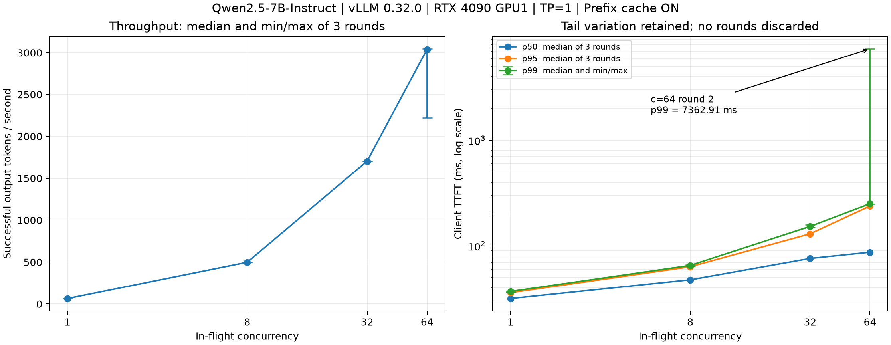

# 2026-11-10：当前服务开启前缀缓存的基线压测

## 元数据与范围

| 项目 | 值 |
|---|---|
| 阶段 | 项目 0，当前服务 prefix caching 开启组 |
| 执行时间 | 2026-11-10 22:05:55—23:00:03，Asia/Shanghai（UTC+8） |
| 实验变量 | 客户端在途并发上限：1 / 8 / 32 / 64，依次执行 |
| 固定条件 | 同一运行中的模型服务、输入文件、输出上限、采样参数和客户端 |
| 缓存状态 | `/metrics` 在实验前后均显示 `enable_prefix_caching="True"` |
| 关闭缓存组 | 未运行；本报告不能给出缓存开启相对关闭的收益 |
| 正式请求 | 每档 3 × 512，共 6144；全部成功 |
| 预热请求 | 每档 128，共 512；全部成功，未计入正式指标 |
| 结果状态 | CLI 退出码 0，事件文件以 `completed` 结束；独立复算核对通过 |

本轮按用户要求使用已经运行的服务，不重启、不清空前缀缓存、不调整服务参数。
已有缓存状态并非冷启动；每档正式测量前先遍历完整的 128 条输入。

## 环境与服务

| 项目 | 实测/记录值 |
|---|---|
| GPU | 2 × RTX 4090，24564 MiB/卡；本轮仅使用物理 GPU1，TP=1 |
| 共享条件 | 开始与结束快照中 GPU0 被其他用户的 SGLang 占用；没有操作它 |
| 驱动 | 580.178.04 |
| CUDA | 驱动支持 13.0；PyTorch wheel 运行时 13.0 |
| Python | uv-managed 3.12.16，使用仓库 `.venv` |
| PyTorch | 2.13.0+cu130（包元数据为 2.13.0） |
| vLLM | 0.32.0；`/version` 也返回 0.32.0 |
| vLLM-Omni | 安装版本 0.32.0，本轮执行文本服务，不是 Omni 性能测试 |
| transformers / httpx | 5.19.0 / 0.28.1 |
| 模型 | `models/Qwen2.5-7B-Instruct` |
| dtype | 启动命令未显式传入，模型配置声明 bfloat16；模型配置快照已保存 |
| 服务参数 | TP=1，max-model-len=8192，gpu-memory-utilization=0.90，max-num-seqs=64 |
| KV cache | 运行时指标：103840 token、6490 个 16-token block，cache_dtype=auto |
| chunked prefill | 命令未显式指定；运行时 `/server_info` 返回 404，未直接验证其有效状态 |

实际进程的 `CUDA_VISIBLE_DEVICES=1` 已从环境白名单核对，完整进程参数见
[observation-context.json](../results/20261110T140555_003380Z_prefix-on_8114dafc/observation-context.json)。以下将仓库前缀写为相对路径：

```bash
CUDA_VISIBLE_DEVICES=1 .venv/bin/python .venv/bin/vllm serve models/Qwen2.5-7B-Instruct \
  --port 8000 --tensor-parallel-size 1 --max-model-len 8192 \
  --gpu-memory-utilization 0.90 --max-num-seqs 64
```

当前进程没有显式缓存开关参数；开启状态由实时指标确认，不凭默认值推测。
模型自带 generation_config 含 repetition_penalty=1.05、top_p=0.8、top_k=20 等默认值；
客户端显式发送 temperature=0 和 max_tokens=128，其余未覆盖项及模型配置均保留快照。
没有把模型文件中的 temperature=0.7 当作本轮请求温度。

## 负载与计时口径

- 输入：`benchmarks/prompts/baseline-v1.jsonl`，128 条，8 类任务，固定顺序。
- SHA256：`a624abd107e8bb3abf3737d4dc33bab4443c678292c721beca42c02435b9c009`。
- 本地默认聊天模板的输入长度为 59—379 token，中位数 78.5；属于短至中等输入混合负载。
- 每请求输出上限 128，不强制忽略 EOS；吞吐始终使用实际 `usage.completion_tokens`。
- 每个正式轮次将输入文件循环 4 次，预热与正式轮的数据分别标记 phase。
- 闭环固定在途并发；等待客户端信号量的时间不进入单请求 TTFT/E2E，但进入整轮墙钟时间。
- TTFT：发送前至首个非空文本 delta。E2E：发送前至收到 `[DONE]`。
- TPOT：`(E2E - TTFT)/(实际输出 token 数 - 1)`，包含末尾 usage/DONE 等待；不是精确逐 token ITL。
- `chunk_itl_ms` 是文本事件到达间隔；不得将 SSE 事件数当作 token 数。
- 每轮 p50/p95/p99 用排序后的 `(n-1)*p` 线性插值；缺失指标不补零。
- 每个分位数列再取 3 轮中位数，不能称为混合全部请求后计算的分位数。
- GPU1 以 1 Hz 采样；按与原始请求相同的主机 perf_counter 时钟筛选正式轮次窗口，峰值跨 3 轮取最大。
- 显存是全卡已用量，包含权重、预分配 KV 和运行时分配；采样峰值可能漏掉不足 1 秒的尖峰。

实际执行的客户端参数（由外部观察脚本作为子进程启动，输出目录位于本次独立目录中）：

```bash
.venv/bin/python -u project0-baseline/scripts/bench.py \
  --model models/Qwen2.5-7B-Instruct \
  --prompts benchmarks/prompts/baseline-v1.jsonl \
  --concurrency 1 8 32 64 --requests 512 --warmup 128 --rounds 3 \
  --timeout 120 --temperature 0 \
  --output-dir project0-baseline/results/20261110T140555_003380Z_prefix-on_8114dafc
```

客户端源码 SHA256：`a2b75ab8964e8c636a979cea10f6454269e92d5074b7a2b11c3472d4c413920c`；实验前后源码与输入校验值一致。
监控脚本本身、客户端源码及输入文件均已保存快照；不依赖之后工作区的修改来解释本轮结果。

## 开启缓存：三轮汇总

吞吐方括号为三轮最小/最大值，其余延迟为每轮对应分位数的中位数。

| 并发 | 输出 tok/s：中位数 [最小, 最大] | 请求吞吐（req/s） | TTFT p50（ms） | TTFT p95（ms） | TTFT p99（ms） | TPOT p50（ms） | 显存峰值（MiB） | 失败/正式请求 |
|---:|---:|---:|---:|---:|---:|---:|---:|---:|
| 1 | 64.38 [64.37, 64.38] | 0.611 | 31.72 | 36.03 | 37.04 | 15.36 | 21129 | 0/1536 |
| 8 | 498.24 [498.21, 498.43] | 4.724 | 47.77 | 63.54 | 65.40 | 15.55 | 21129 | 0/1536 |
| 32 | 1704.42 [1701.86, 1704.74] | 16.175 | 76.15 | 130.19 | 152.94 | 17.49 | 21129 | 0/1536 |
| 64 | 3039.24 [2222.19, 3046.71] | 28.837 | 87.24 | 238.22 | 250.63 | 18.96 | 21169 | 0/1536 |

**并发 64 存在显著波动，不能只看 250.63 ms 的 TTFT p99 中位数：第二轮实际达到 7362.91 ms。**
该轮数据保留，没有删除，也没有为了得到更好结果而替换轮次。

## 每轮明细

| 并发 | 轮次 | 输出 tok/s | req/s | TTFT p50 / p95 / p99（ms） | TPOT p50 / p95 / p99（ms） | 失败数 |
|---:|---:|---:|---:|---|---|---:|
| 1 | 1 | 64.38 | 0.611 | 31.72 / 35.95 / 36.51 | 15.36 / 15.37 / 15.37 | 0 |
| 1 | 2 | 64.37 | 0.610 | 31.90 / 36.03 / 37.04 | 15.36 / 15.37 / 15.37 | 0 |
| 1 | 3 | 64.38 | 0.611 | 31.57 / 36.16 / 37.42 | 15.36 / 15.37 / 15.37 | 0 |
| 8 | 1 | 498.43 | 4.726 | 47.63 / 63.54 / 66.14 | 15.55 / 15.62 / 15.64 | 0 |
| 8 | 2 | 498.24 | 4.723 | 47.77 / 63.81 / 65.40 | 15.55 / 15.62 / 15.64 | 0 |
| 8 | 3 | 498.21 | 4.724 | 47.80 / 61.31 / 64.08 | 15.55 / 15.62 / 15.64 | 0 |
| 32 | 1 | 1704.42 | 16.165 | 76.15 / 138.83 / 152.94 | 17.49 / 17.71 / 17.76 | 0 |
| 32 | 2 | 1704.74 | 16.198 | 76.05 / 127.34 / 149.74 | 17.49 / 17.73 / 17.84 | 0 |
| 32 | 3 | 1701.86 | 16.175 | 76.22 / 130.19 / 158.79 | 17.50 / 17.74 / 17.84 | 0 |
| 64 | 1 | 3039.24 | 28.837 | 87.24 / 238.22 / 250.63 | 19.04 / 19.38 / 19.52 | 0 |
| 64 | 2 | 2222.19 | 21.144 | 89.24 / 7337.63 / 7362.91 | 18.86 / 61.51 / 71.54 | 0 |
| 64 | 3 | 3046.71 | 28.901 | 86.87 / 237.77 / 249.99 | 18.96 / 19.41 / 19.53 | 0 |

## 图表



误差线是三轮观察范围，不是置信区间。右图使用对数纵轴，明确包含并发 64 的第二轮尾延迟。

## 缓存计数与数据核对

- 整个执行窗口（**包含预热**）prefix cache queried token 增量 698984，hit token 增量 631184，token 加权命中率 **90.30%**。
- 这个比值不是请求命中率，也不是仅正式三轮的命中率，不能据此估算关闭缓存后的速度。
- 服务端完成请求计数增量 6656，与客户端全部记录数一致。
- 服务端 generation token 增量 701339，与客户端记录的实际输出 token 总数一致。
- 每档正式输出 token 均值依次为 105.4531、105.4746、105.2982、105.3040；统一上限不等于各请求实际长度完全一致。
- 正式 6144 请求、预热 512 请求均无客户端失败；服务端没有本窗口错误/中止计数增长。
- GPU 采样无错误；实验后 `/health` 调用成功，原服务保持运行。

独立核对没有调用客户端的统计函数：从原始时点和 token 数重算 TTFT、TPOT、E2E、
文本事件间隔及吞吐，用标准库 inclusive quantiles 复核各分位数，再复核 repeats.csv。

## 异常与限制

### 并发 64 第 2 轮暂停现象

- 输出吞吐 2222.19 tok/s，低于第 1 / 3 轮的 3039.24 / 3046.71 tok/s。
- TTFT p95 / p99 为 7337.63 / 7362.91 ms；TPOT p99 为 71.54 ms。
- 34 个请求的 TTFT 超过 1 秒，集中于本轮 request_id 98—131。
- 对齐主机时钟的 GPU1 采样显示：22:59:26—22:59:30 连续 5 个采样点利用率为 0%，显存保持 21167 MiB，随后恢复计算。
- `vllm:num_preemptions_total` 前后均为 0，没有观察到缓存抢占计数增长。
- 没有取得该时段服务端日志/性能 trace，**根因未验证**；不能仅凭这些数据归因为编译、网络、显存不足或模型调度。
- 证据：[原始异常窗口与采样](../results/20261110T140555_003380Z_prefix-on_8114dafc/concurrency-64-round-2-anomaly.json)。

### 其他限制

- 本轮没有关闭缓存对照，不能报告缓存加速比；已有服务未重启，因此不是冷启动实验。
- 并发按 1→8→32→64 顺序执行，机器并非完全隔离，仍存在时间顺序与系统负载影响的可能。
- 只有三个正式轮次，512 请求/轮；p99 是有限样本描述，不是稳定 SLA 的证明。
- 输入多为短至中等长度，输出最多 128 token，不能代表长上下文、长输出或真实到达率负载。
- 共享系统下的 GPU1 全卡显存采样不是请求独立显存，也不是毫秒级精确峰值。
- 开启缓存后吞吐随并发增加，但只测试到 64，不能确定更高并发的绝对饱和点。
- 尚未与官方 `vllm bench serve` 交叉验证；chunked prefill 有效状态未直接读取。

## 结论与下一步

在本次已预热、开启前缀缓存的固定负载下，吞吐中位数随并发 1→64 从 64.38 增至
3039.24 tok/s，同时 TTFT p50 从 31.72 增至 87.24 ms，TPOT p50 从 15.36 增至
18.96 ms。更高并发提高了总吞吐，但也提高了单请求等待和生成间隔；这一现象与批处理
共享执行资源相符，具体瓶颈尚未通过 profiling 证明。

下一步先定位并发 64 第二轮的暂停，再在相同负载、预热、轮数和采样方式下测试关闭缓存组。
官方工具交叉验证也应统一 token 计数、采样和计时口径。未完成项不填入关闭组表格。

## 证据与复核入口

- [每轮 summary.csv](../results/20261110T140555_003380Z_prefix-on_8114dafc/20261110T140555_257856Z_851ff01a/summary.csv)
- [多轮 repeats.csv](../results/20261110T140555_003380Z_prefix-on_8114dafc/20261110T140555_257856Z_851ff01a/repeats.csv)
- [原始请求 requests.jsonl](../results/20261110T140555_003380Z_prefix-on_8114dafc/20261110T140555_257856Z_851ff01a/requests.jsonl)
- [阶段事件 events.jsonl](../results/20261110T140555_003380Z_prefix-on_8114dafc/20261110T140555_257856Z_851ff01a/events.jsonl)
- [实验环境、启动命令与监控配置](../results/20261110T140555_003380Z_prefix-on_8114dafc/observation-context.json)
- [结束状态与前后文件校验](../results/20261110T140555_003380Z_prefix-on_8114dafc/observation-outcome.json)
- [独立数据核对结果](../results/20261110T140555_003380Z_prefix-on_8114dafc/audit.json)
- [GPU1 逐秒采样](../results/20261110T140555_003380Z_prefix-on_8114dafc/gpu-samples.csv)
- [实验前 metrics](../results/20261110T140555_003380Z_prefix-on_8114dafc/server-before.prom) / [实验后 metrics](../results/20261110T140555_003380Z_prefix-on_8114dafc/server-after.prom)
- [客户端源码快照](../results/20261110T140555_003380Z_prefix-on_8114dafc/bench-source.py) / [输入快照](../results/20261110T140555_003380Z_prefix-on_8114dafc/prompts-baseline-v1.jsonl)
- [模型配置](../results/20261110T140555_003380Z_prefix-on_8114dafc/model-config.json) / [模型 generation_config](../results/20261110T140555_003380Z_prefix-on_8114dafc/model-generation_config.json)
- [运行时版本与未验证项](../results/20261110T140555_003380Z_prefix-on_8114dafc/runtime-evidence.json)

从仓库根目录只读复核已有数据（不加 `--save`，避免覆盖已保存的审计文件）：

```bash
.venv/bin/python \
  project0-baseline/results/20261110T140555_003380Z_prefix-on_8114dafc/audit-source.py \
  project0-baseline/results/20261110T140555_003380Z_prefix-on_8114dafc
```

