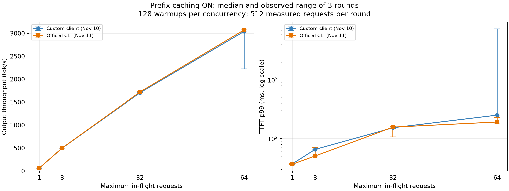

# 2026-11-11：官方 vLLM 工具与自写客户端交叉验证（前缀缓存开启）

## 元数据与范围

四档输出吞吐的三轮中位数全部落在自写脚本的 ±20% 范围内，符合项目 0 的量级交叉验证要求。 最大绝对差异为 **1.07%**。
这是同一运行中服务、相同负载的量级核对；两次实验跨日顺序执行，没有进行交错配对试验。

| 项目 | 实测/记录值 |
|---|---|
| 官方测量时间 | 2026-11-11T12:08:28.992331+08:00 — 2026-11-11T13:05:01.887303+08:00，Asia/Shanghai |
| 对照 | 2026-11-10 自写 `project0-baseline/scripts/bench.py`，保留原三轮数据 |
| 工具变量 | 自写 httpx 客户端 → 安装版本自带的原生 `vllm bench serve`（aiohttp） |
| 固定条件 | 物理 GPU1、TP=1、模型、服务 PID、启动参数、输入顺序、生成参数、并发档位 |
| 官方版本 | vLLM 0.32.0；本轮未修改安装包/上游代码 |
| 预热与正式 | 每档先遍历 128 条预热，再测 3 × 512；4 档共 512 次预热 + 6144 次正式 |
| 成功/失败 | 16 次 CLI 调用全部退出 0；6656 个请求全部成功，无服务端抢占增长 |
| 缓存 | 实验前后指标均为 enable_prefix_caching=True；未清空/重启服务 |
| 关闭缓存组 | 未运行；本报告不能给出缓存开关的因果收益 |

## 环境与服务

- 2 × RTX 4090 24564 MiB，无 NVLink；本轮仅物理 GPU1，GPU0 是其他用户的 SGLang。
- 驱动 580.178.04，驱动支持 CUDA 13.0；PyTorch 2.13.0+cu130，uv Python 3.12.16。
- vLLM / vLLM-Omni 0.32.0，transformers 5.19.0，aiohttp 3.14.5。
- 官方 custom 数据加载补装 pandas 2.3.3 与 pytz 2026.6，已写入开发依赖与环境文档；没有升级推理框架。
- 模型 `models/Qwen2.5-7B-Instruct`，模型配置 dtype=bfloat16。配置、generation_config、tokenizer_config 的 SHA256 与上一轮相同。
- API PID 439160，EngineCore PID 439648；实验前后仍为同一 API 进程与完整启动参数。
- KV 指标仍为 103840 token、6490 个 16-token block；chunked prefill 的有效状态未从配置接口直接验证。

实际服务命令（命令中没有显式 prefix cache 开关；开启状态由实时指标确认）：

```bash
CUDA_VISIBLE_DEVICES=1 .venv/bin/python .venv/bin/vllm serve models/Qwen2.5-7B-Instruct \
  --port 8000 --tensor-parallel-size 1 --max-model-len 8192 \
  --gpu-memory-utilization 0.90 --max-num-seqs 64
```

完整客户端命令和环境白名单见 [context.json](../results/20261111T040828_887286Z_official-prefix-on_55266e02/context.json)。
输入加载检查和模型配置哈希见 [alignment-check.json](../results/20261111T040828_887286Z_official-prefix-on_55266e02/alignment-check.json)。
安装包源码快照与 SHA256 已保存；本机没有 external/vllm checkout，本轮以实际安装版本代码为准。

## 负载对齐

- 原始数据为 `benchmarks/prompts/baseline-v1.jsonl`，128 条、8 类任务；SHA256 为 `a624abd107e8bb3abf3737d4dc33bab4443c678292c721beca42c02435b9c009`。
- 每轮将原始输入循环 4 次成为 512 条；派生 JSONL 只改变条目数量，prompt 文本、顺序、输出上限均保持原样。
- 本地默认聊天模板长度为 59—379 token、中位数 78.5；服务端应用模板一次。
- 官方指定 `--disable-shuffle --no-oversample --skip-chat-template`，避免默认乱序、随机过采样和客户端预套聊天模板。
- temperature=0，生成上限 128，EOS 可提前结束；没有指定 ignore_eos。其余采样参数继承同一个服务的模型默认配置。
- 官方通过 max_completion_tokens=128，自写通过 max_tokens=128 设置相同生成上限。
- 每档用独立的官方 CLI 遍历 128 条作为预热，再调用 3 次正式 CLI；`--num-warmups 0`，避免官方内置预热只重复第一条输入。
- `--request-rate inf --max-concurrency C`；无探针、无额外就绪生成请求，在途数由信号量限制，排队时间不进入单请求 TTFT/E2E。
- 原生 CLI 在每次调用前加载本地 tokenizer；这段启动时间不进入其 benchmark duration。自写脚本的正式统计同样以整轮调度与请求完成为界。

## 官方三轮汇总

下表为每轮指标的三轮中位数，方括号为三轮最小/最大值；不是合并请求后的分位数。
GPU1 每秒采样并以原始 start_times/latencies 筛选正式阶段；显存是整卡已用量，可能漏掉瞬时尖峰。

| 并发 | 官方输出 tok/s：中位数 [最小, 最大] | req/s | TTFT p50 / p95 / p99（ms） | TPOT p50 / p95 / p99（ms） | 显存峰值（MiB） | 失败/正式请求 |
|---:|---:|---:|---|---|---:|---:|
| 1 | 64.45 [64.44, 64.46] | 0.611 | 29.31 / 36.09 / 36.53 | 15.36 / 15.37 / 15.37 | 21169 | 0/1536 |
| 8 | 499.25 [499.17, 499.34] | 4.727 | 47.90 / 49.56 / 50.51 | 15.56 / 15.63 / 15.65 | 21169 | 0/1536 |
| 32 | 1720.99 [1717.14, 1729.47] | 16.359 | 56.21 / 120.13 / 156.61 | 17.51 / 17.75 / 17.88 | 21169 | 0/1536 |
| 64 | 3071.84 [3071.79, 3089.60] | 29.168 | 76.60 / 190.49 / 191.45 | 18.97 / 19.34 / 19.50 | 21169 | 0/1536 |

## 与自写脚本对照

差异 = (官方三轮中位数 / 自写三轮中位数 − 1) × 100%。两侧均使用实际输出 token 统计整轮吞吐。

| 并发 | 自写输出 tok/s | 官方输出 tok/s | 官方相对自写 | 自写 / 官方 TTFT p50（ms） | 自写 / 官方 TPOT p50（ms） |
|---:|---:|---:|---:|---:|---:|
| 1 | 64.38 | 64.45 | +0.10% | 31.72 / 29.31 | 15.36 / 15.36 |
| 8 | 498.24 | 499.25 | +0.20% | 47.77 / 47.90 | 15.55 / 15.56 |
| 32 | 1704.42 | 1720.99 | +0.97% | 76.15 / 56.21 | 17.49 / 17.51 |
| 64 | 3039.24 | 3071.84 | +1.07% | 87.24 / 76.60 | 18.96 / 18.97 |



误差线是三轮观察范围，不是置信区间。TTFT p99 使用对数轴，包含上一轮自写并发 64 第二轮的异常值，没有删除异常轮次。

## 官方每轮明细

| 并发 | 轮次 | 输出 tok/s | req/s | 实际输出 token | TTFT p50 / p95 / p99（ms） | TPOT p50 / p95 / p99（ms） |
|---:|---:|---:|---:|---:|---|---|
| 1 | 1 | 64.44 | 0.611 | 53992 | 29.97 / 36.41 / 37.77 | 15.36 / 15.37 / 15.37 |
| 1 | 2 | 64.45 | 0.611 | 53992 | 29.31 / 36.04 / 36.53 | 15.36 / 15.37 / 15.37 |
| 1 | 3 | 64.46 | 0.611 | 53992 | 29.15 / 36.09 / 36.50 | 15.36 / 15.37 / 15.37 |
| 8 | 1 | 499.34 | 4.729 | 54067 | 47.87 / 49.56 / 50.39 | 15.56 / 15.63 / 15.65 |
| 8 | 2 | 499.17 | 4.726 | 54075 | 47.92 / 49.68 / 70.17 | 15.56 / 15.63 / 15.65 |
| 8 | 3 | 499.25 | 4.727 | 54075 | 47.90 / 49.45 / 50.51 | 15.56 / 15.63 / 15.65 |
| 32 | 1 | 1729.47 | 16.425 | 53911 | 56.13 / 120.85 / 156.61 | 17.40 / 17.68 / 17.78 |
| 32 | 2 | 1717.14 | 16.293 | 53961 | 56.21 / 120.13 / 159.16 | 17.51 / 17.78 / 17.88 |
| 32 | 3 | 1720.99 | 16.359 | 53862 | 56.23 / 89.48 / 106.44 | 17.51 / 17.75 / 17.89 |
| 64 | 1 | 3071.84 | 29.148 | 53958 | 76.60 / 213.21 / 229.39 | 19.00 / 19.42 / 19.50 |
| 64 | 2 | 3089.60 | 29.328 | 53938 | 78.64 / 157.62 / 177.23 | 18.91 / 19.28 / 19.50 |
| 64 | 3 | 3071.79 | 29.168 | 53921 | 75.41 / 190.49 / 191.45 | 18.97 / 19.34 / 19.53 |

## 分析与限制

1. **吞吐交叉验证**：四档输出吞吐的三轮中位数全部落在自写脚本的 ±20% 范围内，符合项目 0 的量级交叉验证要求。 这支持自写脚本的 token 计数、并发和整轮计时没有出现数量级错误；不等于证明所有异常路径都正确。
2. **单请求指标与尾延迟**：TTFT p99 的三轮中位数并非全部在 ±20% 内：并发 8，自写 65.40 ms，官方 50.51 ms，差异 -22.77%；并发 64，自写 250.63 ms，官方 191.45 ms，差异 -23.61%。因此通过的是输出吞吐的量级检查，不能声称所有延迟分位数均通过 ±20% 对齐。尾延迟差异尚未通过交错试验定位。 此外，并发 32 的 TTFT p50 为自写 76.15 ms、官方 56.21 ms，差异 -26.19%。 官方 TTFT 取首个带 choices 的事件，可能是空文本 role 事件；自写取首个非空文本 delta。官方 E2E 到最后一个 choices 事件，自写到 DONE。两者 TPOT 公式相同，但端点时刻略有差别。这些口径差异不构成已证实的尾延迟差异原因。
3. **ITL 不能直接对等**：官方汇集所有请求的事件间隔后计算分位数；自写 chunk_itl_ms 是每请求文本事件间隔均值，再对请求取分位数。事件也不一定对应单个 token。完整官方 ITL、E2E 分位数保留在 CSV/JSON 中。
4. **超时配置差异**：本版本官方源码原生总超时为 6 小时，CLI 未提供相同的 120 秒选项；自写为 120 秒。本轮最大正式请求延迟 2.583 秒，未触及任一上限，未修改官方源码来强行统一。
5. **波动仍需单独看**：自写并发 64 第 2 轮吞吐 2222.19 tok/s、TTFT p99 7362.91 ms，34 次 TTFT 超过 1 秒，同期出现 GPU 短暂空闲；原因未定位。本轮官方正式请求没有 TTFT 超过 1 秒的记录。 两次测试不是同时进行，不能把波动差异直接归因客户端。
6. **缓存收益未验证**：两轮都是热缓存状态；官方正式阶段 token 加权缓存命中率 91.77%（592128/645216），不是请求命中率，也不能据此推导关闭缓存的速度。
7. **显存差异**：官方开始前 GPU1 已用 21169 MiB；此前自写低并发阶段为 21129 MiB、并发 64 达到 21169 MiB。不能把这 40 MiB 的已有状态差异归因官方客户端。
8. **适用范围**：这是共享服务器、短至中等输入、输出上限 128、单卡 TP=1 的交叉检查，没有锁频或交错随机化；不能推广到长输入、多卡、其他模型或冷缓存场景。

## 失败记录与数据核对

- 首次尝试因缺少 pandas，在读取数据集时退出 1；服务端请求/token 计数均无增长。原始失败目录保留为 `20261111T040739_414898Z_official-prefix-on_cee1ccc3`，未覆盖。
- 补装依赖后使用全新目录完整运行，未复用失败产物冒充结果。
- 独立复算确认：6656 个请求与 701739 个实际输出 token 的客户端总数和服务端计数一致；每个阶段也逐项对应。
- 从原始数组重算 TTFT、TPOT、E2E、ITL 的 p50/p95/p99，以及 tok/s 和 req/s；核对全部通过。
- 输入原始顺序与四次循环、输出 cap、错误字段、退出码、服务 PID/命令、无抢占和 GPU 采样错误检查通过。
- [核对结果](../results/20261111T040828_887286Z_official-prefix-on_55266e02/audit.json)、[每轮 CSV](../results/20261111T040828_887286Z_official-prefix-on_55266e02/official-rounds.csv)、[预热 CSV](../results/20261111T040828_887286Z_official-prefix-on_55266e02/official-warmup.csv)、[对照 CSV](../results/20261111T040828_887286Z_official-prefix-on_55266e02/comparison.csv)、[原始运行事件](../results/20261111T040828_887286Z_official-prefix-on_55266e02/events.jsonl)。
- 所有正式 JSON 保留逐请求 start_times、TTFT、latency、实际 token 数、ITL、文本与错误字段；本轮没有改动自写客户端。

## 复现方式

从仓库根目录运行，先确认当前服务版本、启动参数和前缀缓存状态与上述一致，且 GPU1 没有其他实验流量。
以下命令复用本次已校验的 512 条派生输入，为新实验创建独立输出目录：

```bash
set -euo pipefail
export HF_HUB_OFFLINE=1 TRANSFORMERS_OFFLINE=1
export NO_PROXY=127.0.0.1,localhost no_proxy=127.0.0.1,localhost
OUT="project0-baseline/results/$(date -u +%Y%m%dT%H%M%S)_official-recheck"
mkdir "$OUT"
DATA512="project0-baseline/results/20261111T040828_887286Z_official-prefix-on_55266e02/prompts-512-in-order.jsonl"
common=(.venv/bin/vllm bench serve
  --model models/Qwen2.5-7B-Instruct --tokenizer models/Qwen2.5-7B-Instruct
  --backend openai-chat --base-url http://127.0.0.1:8000 --endpoint /v1/chat/completions
  --dataset-name custom --disable-shuffle --no-oversample --skip-chat-template
  --custom-output-len 128 --temperature 0 --request-rate inf --seed 42
  --num-warmups 0 --ready-check-timeout-sec 0 --disable-tqdm
  --percentile-metrics ttft,tpot,itl,e2el --metric-percentiles 50,95,99
  --save-result --save-detailed --result-dir "$OUT")
for c in 1 8 32 64; do
  "${common[@]}" --max-concurrency "$c" --num-prompts 128 \
    --dataset-path benchmarks/prompts/baseline-v1.jsonl --result-filename "c$c-warmup.json"
  for r in 1 2 3; do
    "${common[@]}" --max-concurrency "$c" --num-prompts 512 \
      --dataset-path "$DATA512" --result-filename "c$c-round$r.json"
  done
done
```

上述 CLI 参数组合均已在本轮实际执行；监控器记录的完整原始 argv 见 context.json。
独立观察脚本保存在本次目录 runner.py；它含本轮 PID，属于执行记录，换服务后应重新发现 PID。
